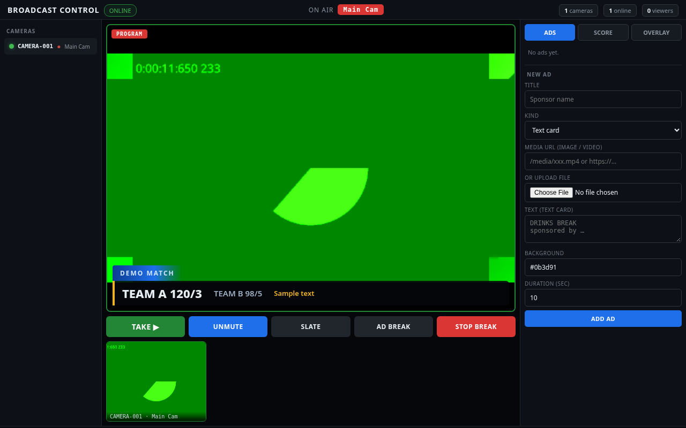
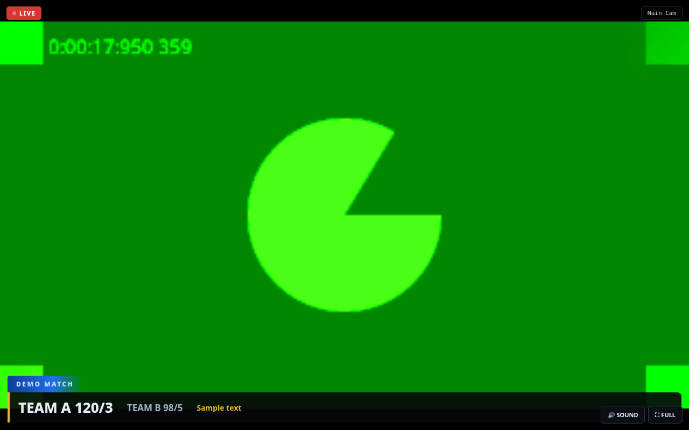
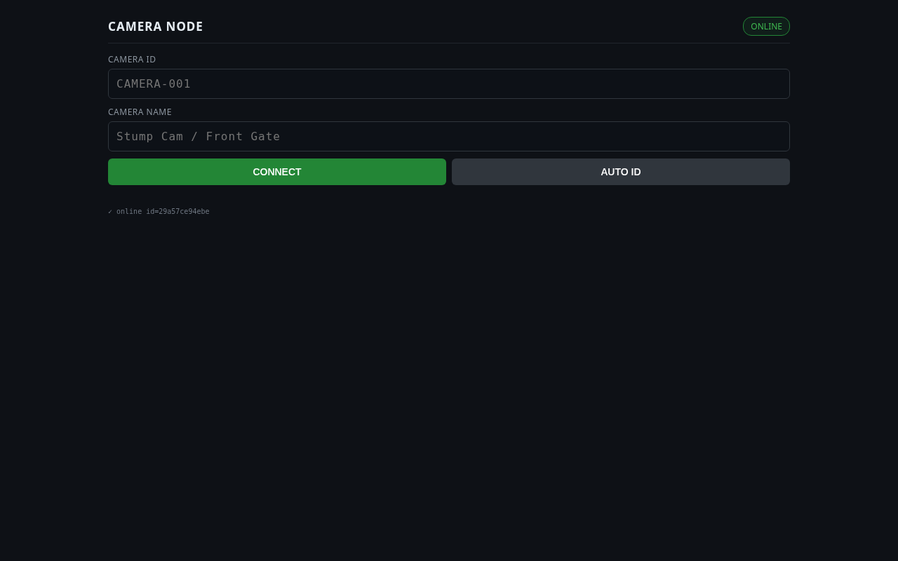
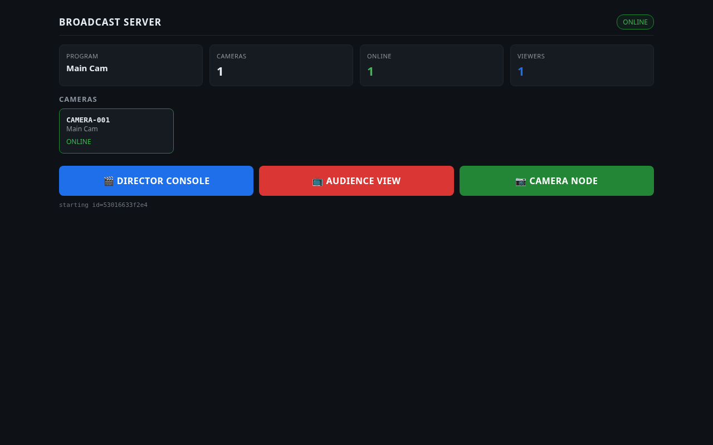
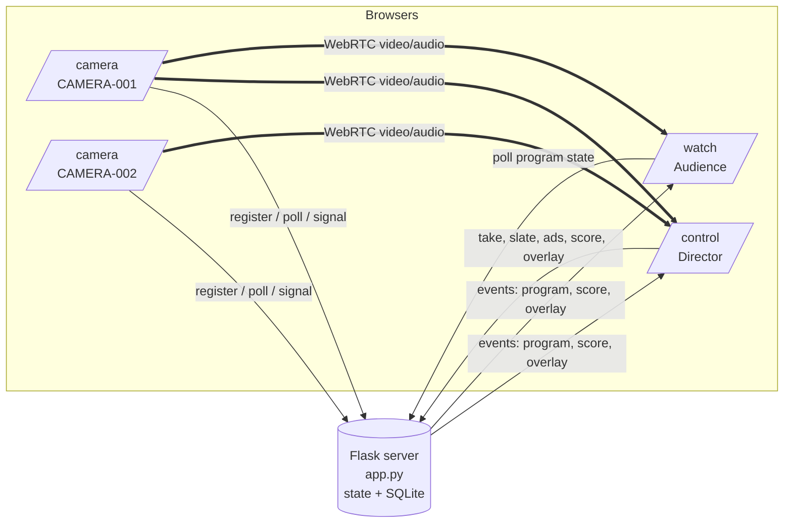

# Live Video Broadcast — Multi-Camera Web Control Room

> A self-hosted, browser-based live broadcast studio: phones act as cameras, a director console cuts between them and runs ads, a scoreboard and overlays, and viewers watch the program feed — all with **Flask + WebRTC**, no external streaming service.


> **Live demo:** none — this is a self-hosted tool that needs your own cameras. The screenshots below come from a real local run.

## Screenshots

Captured at 1280×800 from a local run, using Chromium's built-in *fake camera* (the green test pattern) so that the full WebRTC path was exercised end-to-end.

| Director console (program, scoreboard, ads) | Audience view |
| --- | --- |
|  |  |

| Camera node | Server dashboard |
| --- | --- |
|  |  |

## Features

- **Multi-camera input** — any phone or laptop browser opens `/camera`, registers as `CAMERA-001`, `CAMERA-002`, … (an "AUTO ID" button picks the next free id) and streams video + audio.
- **Director console (`/control`)** — live previews of every online camera, a program monitor, and one-click **TAKE** to put a camera on air; **SLATE** for a standby card with custom text.
- **Ads and breaks** — add text, image or video ads (upload files or give a URL, with a duration), play a single ad, or run an **AD BREAK** that plays the playlist in order and then returns to the previous program.
- **Scoreboard / lower third** — title, two lines and a note, shown or hidden on air in real time.
- **Overlays** — header and footer tickers (scrolling or static, with colours, speed and font size) and a logo overlay.
- **Audience page (`/watch`)** — fullscreen player showing the current program with the overlays, ads and scoreboard, plus a viewer count on the console.
- **Resilience** — cameras that stop polling are marked offline automatically; if the on-air camera drops, the program falls back to a "SIGNAL LOST" slate.
- **Camera registry** — cameras and their last-seen status are kept in a local SQLite database.
- **Mobile-first deployment** — `start.sh` runs the server on Termux (Android) and exposes it through a Cloudflare quick tunnel so phones on any network can join.

## Tech stack

| Layer | Tools |
| --- | --- |
| Server | Python, Flask (threaded), SQLite (`sqlite3`) |
| Realtime | WebRTC (`RTCPeerConnection`, public Google STUN server) with HTTP long-polling for signalling and events |
| Frontend | Server-rendered templates with vanilla JavaScript, no framework or build step |
| Transport | HTTPS (required for camera access), optional `cloudflared` tunnel |

## How it works



1. Every browser polls `GET /poll` and receives queued events (`program`, `score`, `overlay`, `camera_status`, WebRTC `offer` / `answer` / `ice`).
2. Cameras register with `POST /register`. The server relays WebRTC signalling messages between peers through `POST /signal`; media itself flows peer-to-peer.
3. The director and each viewer open a WebRTC connection to the cameras they need. The server only holds the **program state** (which source is on air, the active ad, the scoreboard and overlays) and broadcasts changes.
4. The audience page shows whichever camera is currently the program source and applies the overlays on top.

### HTTP API (summary)

| Endpoint | Purpose |
| --- | --- |
| `GET /api/state`, `GET /health` | Current program, score, ads, cameras, overlay, viewer count |
| `POST /api/take` · `POST /api/slate` | Put a camera / a slate card on air |
| `POST /api/ad/play` · `POST /api/break/start` · `POST /api/break/stop` | Play one ad, run or stop an ad break |
| `GET/POST /api/ads` · `DELETE /api/ads/<id>` · `POST /api/upload` | Manage the ad playlist and media uploads (`.mp4 .webm .ogv .jpg .png .gif .webp`) |
| `POST /api/score` · `POST /api/overlay` | Scoreboard and overlay settings |

## Getting started

```bash
git clone https://github.com/ppro916/LiveVideoBrodcast.git
cd LiveVideoBrodcast
python3 -m venv .venv && source .venv/bin/activate
pip install -r requirements.txt
python app.py            # serves https://0.0.0.0:5050 with a self-signed certificate
```

Then open (accept the browser's self-signed certificate warning):

| Role | URL |
| --- | --- |
| Server dashboard | `https://localhost:5050/` |
| Camera | `https://<host>:5050/camera` |
| Director | `https://<host>:5050/control` |
| Audience | `https://<host>:5050/watch` |

**Android (Termux) + public tunnel:** run `./start.sh`. It installs `cloudflared` if needed, starts the server and prints a `https://*.trycloudflare.com` URL; use `<URL>/camera`, `<URL>/control` and `<URL>/watch` from any device.

## Configuration

All configuration is through environment variables (see [`.env.example`](.env.example)):

| Variable | Default | Description |
| --- | --- | --- |
| `PORT` | `5050` | Port to listen on |
| `HOST` | `0.0.0.0` | Bind address |
| `SSL_CERT_FILE` | `certs/cert.pem` | Path to your TLS certificate |
| `SSL_KEY_FILE` | `certs/key.pem` | Path to your TLS private key |

If no certificate/key pair is found, the server generates a throw-away self-signed certificate in memory at start-up. **Never commit a private key**; `.gitignore` excludes `certs/` and `*.pem`.

## Known limitations

- There is **no authentication** on `/control` or the API: anyone who can reach the URL can operate the broadcast. Keep the tunnel URL private or put the app behind an authenticating proxy.
- Each viewer connects to the on-air camera directly (peer-to-peer), so the number of viewers is limited by the camera device's upload bandwidth, and only a public STUN server is configured (no TURN), so some restrictive networks may fail to connect.
- State (program, ads in memory) is held by a single server process; ads are persisted to `ads.json`.

## Roadmap

- [ ] Add authentication for the director console
- [ ] Optional TURN server configuration through environment variables
- [ ] Relay through an SFU to support larger audiences
- [ ] Automated tests for the program/ad-break state machine

## Author

**Moreshwar Bhonde** — AI & Data Science engineering student, AI-first developer, founder of AI Nexus × Neon AI Studio.

- GitHub: [@ppro916](https://github.com/ppro916)
- Website: [neonaistudio.in](https://neonaistudio.in)

## License

[MIT](LICENSE)
